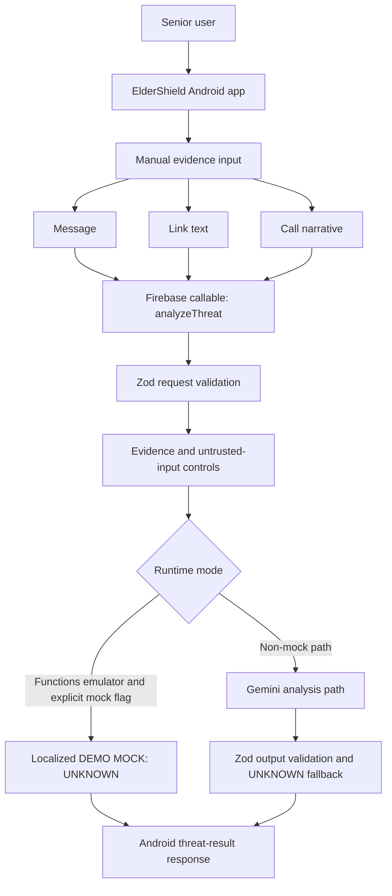

# ElderShield AI

**AI-powered prototype for user-initiated review of suspicious messages, links, and call narratives.** The verified hackathon demo is an API-only local mock: it always returns `UNKNOWN` and does not assess submitted content.

## Problem

Older adults may receive communications that use urgency, impersonation, or requests for money and sensitive information. Reviewing them can be difficult without accessible explanations and a trusted next step.

## Solution

ElderShield is a multilingual safety assistant prototype. The Android app lets a person submit text for a backend analysis path, then presents a threat state and recommended action. The backend has conservative validation and `UNKNOWN` fallbacks. The Codespaces demo uses a clearly labeled deterministic mock, not Gemini.

Results are guidance, not proof that content or a sender is safe. ElderShield does not verify caller identity, open URLs, or consult live threat-intelligence services.

## Key Features

- Manual message, pasted-link, and call-narrative workflows.
- English, Bengali, and Hindi resources; selected language is persisted with DataStore.
- SAFE, WARNING, DANGER, and UNKNOWN result states with explanation and action text.
- Firebase callable with input/output schema validation, evidence controls, a 1,000-character input limit, Gemini timeout, and conservative UNKNOWN fallbacks.
- Emulator-only local mock that always returns localized `UNKNOWN`, clearly labeled `DEMO MOCK / ডেমো মক / डेमो मॉक`.

## Architecture



## Technology Stack

- Android: Kotlin, Jetpack Compose, Android Gradle Plugin 8.1.1, SDK 34, minimum SDK 26.
- Build: Gradle wrapper 8.4, Kotlin 1.9.10, JDK 17.
- Backend: Firebase Functions v2 callable, TypeScript, Zod; Functions package targets Node.js 20.
- AI integration path: Google GenAI SDK and Gemini 2.5 Flash, with server-side Firebase Secret Manager binding.
- Tests: JUnit/MockK/coroutines-test and Vitest.

## Current Implementation

- Android screens and backend code are implemented; the debug APK compiles and Android unit tests pass.
- The local callable mock is opt-in, emulator-only, and returns `UNKNOWN` for every input. It explicitly states no assessment took place.
- Outside mock mode, the function contains a Gemini request path. Live Gemini has not been verified.
- The working local demo covers the Firebase callable API; Android device/UI behavior is not verified.
- The app's current client configuration targets the local Functions emulator. Production Firebase configuration does not exist.

## Verified Evidence

- 35 Functions unit tests pass, including schema validation, timeout cancellation, mock isolation, multilingual fixtures, and provider-failure fallback.
- TypeScript build passes.
- Android unit tests, lint, and debug APK assembly pass. Lint currently reports 26 warnings.
- The Functions emulator smoke matrix passed 11 HTTP cases against `demo-eldershield` in local mock mode.
- Android UI/device E2E and live Gemini are not verified.

See [docs/VERIFICATION.md](docs/VERIFICATION.md) for reproducible commands and [docs/HACKATHON_EVIDENCE.md](docs/HACKATHON_EVIDENCE.md) for the feature matrix and presentation evidence.

## Codespaces Setup

Development is Codespaces-first. VS Code Desktop on Windows is only the remote editor/client; Java, Gradle, Android SDK, Node/npm, Firebase CLI, and all builds/tests run inside the Codespace. No local Windows development toolchain is required.

The verified Codespace has JDK 17 and Android SDK platform 34 at `/opt/android-sdk`. Export its SDK variables in the Codespace terminal:

```bash
export ANDROID_HOME=/opt/android-sdk
export ANDROID_SDK_ROOT=/opt/android-sdk
npm ci
npm --prefix functions ci
```

Functions declares Node 20. The current Codespace has Node 24 and Firebase CLI warns about the mismatch; Node 20 runtime parity is outstanding.

Run Android validation in the Codespace:

```bash
./gradlew test
./gradlew lint
./gradlew assembleDebug
```

The debug APK is generated at `app/build/outputs/apk/debug/app-debug.apk`.

## Local Demo

No Gemini key is needed. This is an API-only Firebase emulator demo. Use two terminals inside the Codespace.

**Terminal 1:**

```bash
npm --prefix functions run build
cp functions/demo-eldershield.env.example functions/.env.demo-eldershield
./node_modules/.bin/firebase emulators:start --project demo-eldershield --only functions
```

**Terminal 2:**

```bash
node functions/scripts/demo-emulator-smoke.cjs
```

The script verifies the ignored env file contains only the mock flag, calls the local `demo-eldershield` callable, asserts responses, prints per-case PASS/FAIL and a final 11/11 tally. It prints `MODE: LOCAL DETERMINISTIC DEMO`, `AI PROVIDER: MOCKED`, and `LIVE GEMINI: NOT VERIFIED`. Stop the emulator with Ctrl+C in Terminal 1. No production endpoint is selected.

## Synthetic Demo Cases

All scenarios are synthetic. URLs use the reserved `.invalid` domain and must not be opened as real destinations.

1. Bank/payment message: `DEMO ONLY: Example Bank requests a one-time demo code to release a test payment.`
2. Suspicious-looking link: `https://s.example.invalid/a1b2`
3. Call narrative: a synthetic caller claims to represent Example Bank and asks for a demo code.
4. Bengali suspicious message.
5. Hindi suspicious message.
6. Insufficient call evidence: `CALL DESCRIPTION:   `, expected `UNKNOWN`.

The local mock returns `UNKNOWN` for all inputs; it does not label any content as a real scam. Unsupported language and malformed request cases validate `INVALID_ARGUMENT` handling. Provider failure is covered by the mocked Gemini unit test.

## Security Model

- Implemented: 1,000-character input limit; Zod request and response schemas; untrusted-input framing; evidence limitations; 10-second Gemini abort; 15-second function timeout; generic errors and UNKNOWN fallback; secret reference through `defineSecret`.
- Partial: prompt injection defenses are best-effort, not guarantees; generation is capped at 300 tokens but output text fields lack separate maximum lengths; individual call limits do not replace project quotas.
- Missing: authentication enforcement, Firebase App Check enforcement, rate limiting, persistent abuse controls, and production monitoring/cost alerts.
- Privacy: outside mock mode, submitted text is sent to Firebase and Gemini. The local mock does not analyze content. Do not expose the callable publicly until production protections and privacy requirements are addressed.

## Current Limitations

- No Android AVD/device exists in the current Codespace. UI display, navigation, language persistence after restart, and `10.0.2.2` routing are not device-verified.
- Live Gemini is NOT VERIFIED. Never describe mock responses as AI classifications.
- No automatic SMS/call detection, call blocking, caller identity lookup, or URL reputation check.
- No production Firebase project configuration or deployment.
- Node 20 is declared but unavailable in the current Codespace; validation/emulator used Node 24.
- The API mock demo does not demonstrate the Android UI.

## Production Roadmap

Before any public deployment: select and authorize a Firebase project; separate emulator and release configurations; configure authentication policy and enforce App Check; implement server-side rate limits, quotas, cost controls, monitoring, and redacted logs; provision Gemini only through Secret Manager; complete privacy/accessibility review; test release APKs and authorized live integrations.

See [docs/PRODUCTION_READINESS.md](docs/PRODUCTION_READINESS.md). **Current status: NOT PRODUCTION READY.**

## Hackathon Demo

The currently verified presentation is Level 1: Codespaces terminal, Firebase callable, synthetic inputs, localized mock response, and validation/fallback behavior. It is a deterministic API demonstration, not live AI and not Android UI E2E.

Level 2, an Android UI demonstration, is available only after a real emulator/device can be accessed and the UI flow is observed. No emulator image was installed for this project. The proposed 3-minute demo script and evidence references are in [docs/HACKATHON_EVIDENCE.md](docs/HACKATHON_EVIDENCE.md).
