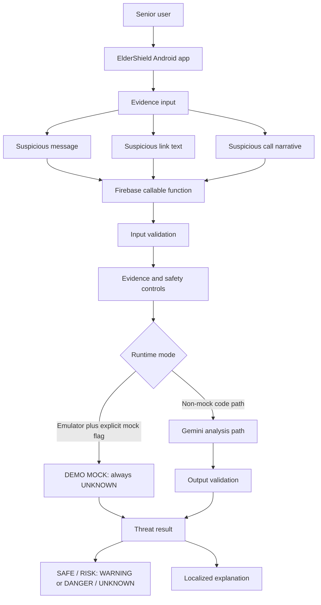
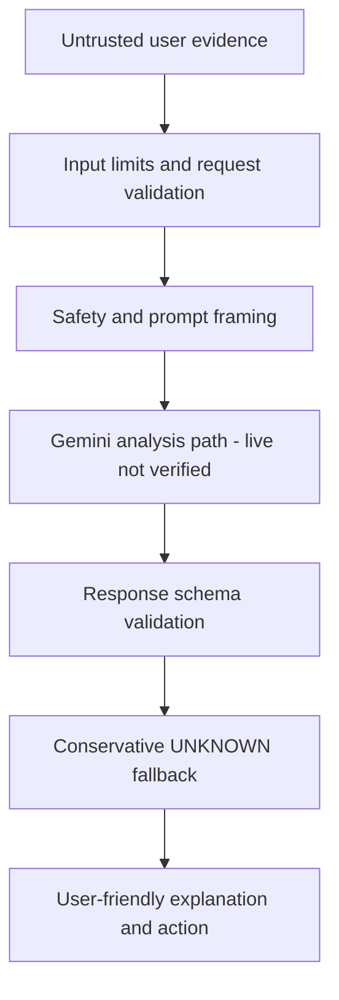

# Hackathon Evidence Brief

**Project:** ElderShield AI
**Positioning:** AI-powered prototype; multilingual safety assistant; production hardening remains.
**Evidence date:** 2026-10-01
**Do not claim:** live Gemini, automatic interception, caller/URL verification, device UI testing, production deployment, or certainty about safety.

## 1. Problem

Older adults may receive messages, links, and calls that use urgency, impersonation, or requests for sensitive information. ElderShield's design goal is to make user-submitted content easier to examine and explain in accessible language. No user research or impact study has been completed; avoid quantified problem or outcome claims without external evidence.

## 2. Target Users

Older adults who want help reviewing a suspicious message, link, or call narrative, and trusted supporters assisting them. The current prototype requires a user to manually enter or paste content.

## 3. Solution

A user-initiated Android prototype sends text to a Firebase callable and presents a threat state, simple explanation, and recommended action. The backend validates inputs and outputs and conservatively returns UNKNOWN when evidence or a valid model response is unavailable. In the local hackathon API demo, an explicit emulator-only mock always returns UNKNOWN and clearly says no assessment occurred.

## 4. User Workflow

1. Choose message, link, or call narrative in the Android app.
2. Enter or paste the text; the app does not intercept communications.
3. The view model sends content type, content, and selected language through `ThreatAnalysisService`.
4. Firebase callable validates the request and applies the call-evidence guard.
5. In emulator demo mode, return a localized DEMO MOCK UNKNOWN response; otherwise the code attempts Gemini.
6. The Android service maps the callable result to a threat result screen.

Android-to-Firebase UI behavior is not device-tested in this environment; this workflow describes implemented code paths, not verified UI E2E.

## 5. Architecture

**Gemini analysis path:** implemented in source, but not live-tested. **Local demo:** the guarded emulator branch returns a labeled UNKNOWN without calling Gemini. The Android result UI is compiled and unit-tested, but no device was available to verify its rendering.

## 6. AI Layer

| Claim | Repository evidence | Status |
|---|---|---|
| Server-side Gemini 2.5 Flash request path exists | `functions/src/index.ts`, model request config | 🟡 IMPLEMENTED / LIVE GEMINI NOT VERIFIED |
| API key is referenced through Firebase Secret Manager binding | `defineSecret("GEMINI_API_KEY")` in `functions/src/index.ts` | 🟡 IMPLEMENTED / production secret not configured |
| Emulator can run without Gemini and will not claim analysis | Guarded emulator mock in `functions/src/index.ts`; ignored local env flag | ✅ VERIFIED in local callable HTTP matrix |
| Mock output can be described as AI classification | It always emits UNKNOWN and explicitly says no content assessment occurred | 🔴 NOT A VALID CLAIM |

## 7. Safety Architecture

Evidence: Zod enforces MESSAGE/LINK/CALL, en/bn/hi, nonblank content, and a 1,000-character cap in `functions/src/validators/schema.ts`. Call number alone/empty narrative returns UNKNOWN. Prompt framing treats submitted text as untrusted and limits caller/URL claims; this is defense-in-depth, not a prompt-injection guarantee. Gemini has a 10-second abort signal and the function timeout is 15 seconds. Output schema checks status, confidence, category, language, explanation, and action. The local emulator substitutes the Gemini step with the labeled mock and always returns UNKNOWN. No SMS/call interception, URL reputation, or caller identity verification is implemented.

## 8. Multilingual Support

- Android resource sets exist for English, Bengali, and Hindi: `app/src/main/res/values/`, `values-bn/`, and `values-hi/`.
- Selected language is persisted using DataStore: `app/src/main/java/com/eldershield/ai/data/preferences/LanguagePreferences.kt` and its unit test.
- Backend accepts en/bn/hi, requests output in the selected language, and its local emulator mock returns localized labels/actions.
- Backend language behavior is covered by Vitest and the emulator smoke matrix. Android UI language switching/persistence has not been device-tested.

## 9. Feature Evidence Matrix

| FEATURE | IMPLEMENTATION | VERIFICATION | STATUS |
|---|---|---|---|
| Senior-focused threat analysis | Accessible, user-initiated prototype with large text and simple result copy | Android source, unit tests, lint, APK build; no usability study/device evaluation | IMPLEMENTED / NOT FULLY VERIFIED |
| Message analysis | Manual text-entry flow to the shared service and callable contract | Unit tests and emulator mock cases A-C; mock returns UNKNOWN without assessing content | IMPLEMENTED / NOT FULLY VERIFIED |
| Link analysis | Manual link-text flow; destination is not opened or reputation-checked | Prompt evidence-limit tests and emulator mock cases D-E | IMPLEMENTED / NOT FULLY VERIFIED |
| Call narrative analysis | User-entered narrative; phone number alone is insufficient | Unit tests and emulator mock cases F-I | IMPLEMENTED / NOT FULLY VERIFIED |
| Multilingual support | en/bn/hi resources and language code in the backend contract | Resource build, unit tests, emulator response-language assertions | IMPLEMENTED / NOT FULLY VERIFIED |
| English | Android resources and en backend responses | Build/tests and emulator matrix | IMPLEMENTED / NOT FULLY VERIFIED |
| Bengali | Android resources and bn backend responses | Build/tests and emulator matrix with Bengali mock label | IMPLEMENTED / NOT FULLY VERIFIED |
| Hindi | Android resources and hi backend responses | Build/tests and emulator matrix with Hindi mock label | IMPLEMENTED / NOT FULLY VERIFIED |
| UNKNOWN fallback | Insufficient evidence/provider/parse/timeout failures return UNKNOWN | 35 Functions tests and emulator case I | VERIFIED |
| Firebase callable backend | Functions v2 callable `analyzeThreat` | 11/11 local emulator HTTP cases passed | VERIFIED |
| Gemini integration path | Google GenAI SDK configured for Gemini 2.5 Flash with server-side secret binding | Source and mocked SDK tests; no authorized live request | IMPLEMENTED / NOT FULLY VERIFIED |
| Safety validation | Zod request/response schemas, input limit, call-evidence guard | Deterministic tests including invalid and malformed payload/response cases | VERIFIED |
| Evidence limits | Prompt limits analysis to supplied text; no caller or URL verification claims | Prompt tests and UNKNOWN call-evidence case | VERIFIED |
| Error handling | Generic validation error and conservative UNKNOWN provider/error fallback | Functions tests and emulator invalid-request cases | VERIFIED |
| Android application | Compose app, navigation, screens, and threat-result UI | Android unit tests, lint, APK build; no device UI run | IMPLEMENTED / NOT FULLY VERIFIED |
| DataStore language persistence | Selected language stored in Android DataStore | `LanguagePreferencesTest.kt`; no app-restart UI test | IMPLEMENTED / NOT FULLY VERIFIED |
| Security controls | Validation, prompt boundaries, timeouts, and secret binding; production access controls absent | Source/tests; no auth, enforced App Check, or rate limiting | IMPLEMENTED / NOT FULLY VERIFIED |
| Automatic SMS/call detection | Not implemented | No communication-access permissions or interception workflow | NOT IMPLEMENTED |
| Android UI/device E2E | Requires an Android device/AVD | No device or AVD in the current Codespace | BLOCKED |

## 10. Verification Evidence

| Check | Command/evidence | Result |
|---|---|---|
| Functions unit suite | `npm --prefix functions test` | 35 tests passed; includes mocked Gemini, timeout, input/output validation, and emulator-mock isolation |
| Functions compile | `npm --prefix functions run build` | TypeScript build passed |
| Android unit tests | `ANDROID_HOME=/opt/android-sdk ANDROID_SDK_ROOT=/opt/android-sdk ./gradlew test` | Passed |
| Android lint and APK | `ANDROID_HOME=/opt/android-sdk ANDROID_SDK_ROOT=/opt/android-sdk ./gradlew lint assembleDebug` | Passed; 26 non-fatal lint warnings; APK generated |
| Emulator matrix | `node functions/scripts/demo-emulator-smoke.cjs` with the Functions emulator running as `demo-eldershield` | 11/11 HTTP cases passed; no Gemini call |
| Device/UI | `adb devices -l` empty; no emulator binary or AVD | ⚠️ BLOCKED IN CURRENT CODESPACE |
| Live Gemini | No developer key/request | 🔴 NOT VERIFIED |
| Deployment | No deployment command run | 🔴 NOT DEPLOYED |

The emulator matrix verifies callable protocol behavior and a no-analysis mock. It does not measure model accuracy or verify Android UI behavior.

## 11. Demo Workflow

Codespaces-only API demo:

1. Terminal 1: build Functions, copy the mock-only example env, and start only Functions for the demo project.
2. Terminal 2: run `node functions/scripts/demo-emulator-smoke.cjs`.
3. Expect a presentation-friendly 11/11 summary with mode/provider/live-Gemini disclosures.
4. Stop the emulator with Ctrl+C.

See the exact commands and safe synthetic inputs in [README.md](../README.md). The reusable script refuses to run unless the ignored env file contains exactly the mock flag. Responses are always UNKNOWN and clearly labeled.

## 12. Limitations

- No Android AVD/device exists in this Codespace; no Android UI E2E, screenshot, or 10.0.2.2 routing evidence.
- No live Gemini request; mocked and emulator mock responses must not be presented as classifications.
- Functions target Node 20; current Codespace has Node 24 and Firebase CLI warns about the mismatch.
- No production Firebase Android configuration, deployment, authentication enforcement, App Check, or rate limiting.
- No automatic SMS/call detection, call blocking, external URL reputation, or caller identity check.
- User-entered content is sent to Firebase and, outside emulator mock mode, to Gemini; production privacy/retention review remains.

## 13. Future Roadmap

1. Use a Codespace-accessible Android device/AVD if one becomes available without large downloads; then test navigation, localization, DataStore persistence, result/error states, and callable routing.
2. Align the Codespace Functions runtime with Node 20.
3. Add authentication/App Check/rate limiting and cost monitoring before any public endpoint.
4. Run an explicitly authorized live Gemini evaluation, recording test prompts and outcomes without including keys or personal data.
5. Complete privacy/accessibility review and establish release/deployment controls.

## 14. Impact

The verified evidence supports a working local prototype and a repeatable callable demonstration, not a proven reduction in scams or user harm. For a future impact evaluation, measure comprehension of explanations, correct use of UNKNOWN, task completion across supported languages, and false reassurance rates with consented participants and an approved study protocol.
