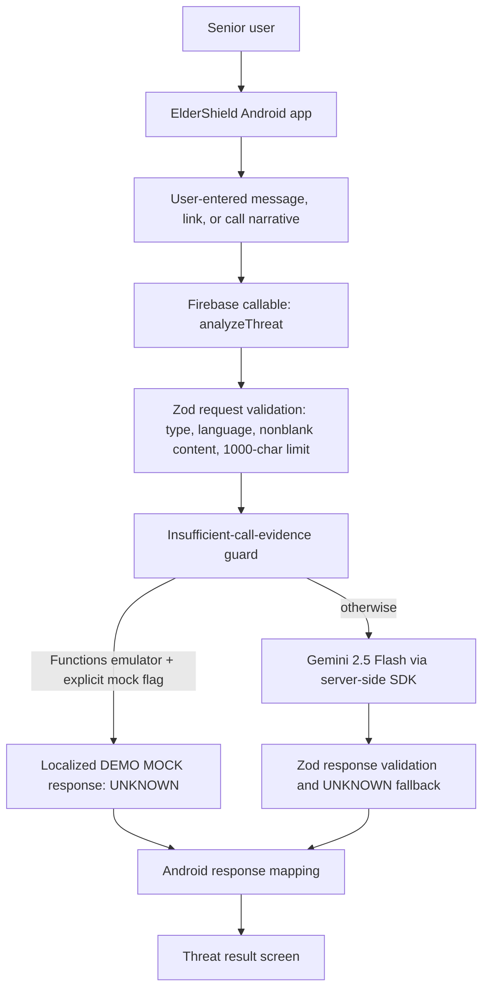
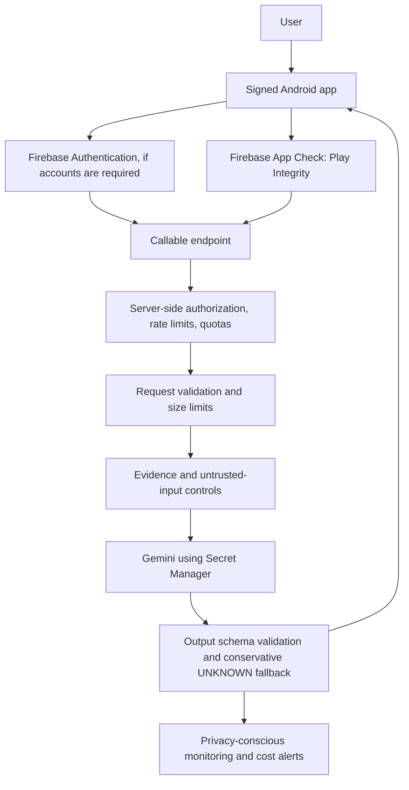

# Production Readiness

**CURRENT STATUS: NOT PRODUCTION READY**

No production Firebase configuration, deployment, live Gemini request, Android UI/device run, or production-control enforcement has been verified. This document records the current gaps; it is not a deployment approval.

## Current Local Architecture

The emulator mock returns `UNKNOWN` for all content and states that no assessment occurred. It is enabled only when both `FUNCTIONS_EMULATOR=true` and `ELDERSHIELD_USE_MOCK_GEMINI=true` are present. The opt-in example is `functions/demo-eldershield.env.example`; the copied `.env.demo-eldershield` is ignored by Git. Production execution ignores the mock flag and binds `GEMINI_API_KEY`.

## Proposed Production Architecture

This is a target, not an implemented or deployed architecture. App Check is not authentication, and neither replaces server-side rate limiting.

## Production Gaps

| Control | Status | Current evidence / required work |
|---|---|---|
| Input limits and validation | IMPLEMENTED | Zod restricts content type and language, trims/rejects blank content, and caps input at 1,000 characters. Reassess for product-specific needs. |
| Output limits | PARTIAL | Gemini request caps generation at 300 tokens and Zod validates output enums/confidence/required fields. Output text lengths are not separately capped in the response schema. |
| Prompt injection / untrusted content | PARTIAL | User text is delimited and called untrusted; the system prompt instructs the model to ignore embedded commands. This is defense-in-depth, not a guarantee against prompt injection. |
| Evidence claims | IMPLEMENTED | Prompt explicitly limits URL and caller claims to supplied evidence; phone-only call input returns UNKNOWN. There is no URL reputation or caller identity service. |
| Gemini timeout | IMPLEMENTED | SDK request uses an AbortSignal at 10 seconds; Functions timeout is 15 seconds. Unit test verifies cancellation and UNKNOWN fallback. |
| Error handling | IMPLEMENTED | Invalid requests return generic INVALID_ARGUMENT; provider/parse failures return generic UNKNOWN. Do not expose raw provider errors to clients. |
| Gemini secret | PARTIAL | Source uses Firebase `defineSecret("GEMINI_API_KEY")`; no production secret binding/configuration was verified. Set it only in the authorized production project's Secret Manager. |
| Application logging | PARTIAL | Reviewed function code does not log submitted content. Firebase platform logs invocation metadata. Establish redaction/retention policy and verify logs/monitoring never capture raw content. |
| Authentication | MISSING | Callable does not require `request.auth`. Decide whether the product needs accounts and enforce server-side authorization accordingly. |
| App Check | MISSING | Callable does not set `enforceAppCheck`. Register Android Play Integrity and a local debug provider, validate clients, then enforce. |
| Rate limiting | MISSING | No per-user/per-IP persistent rate limit exists. Implement server-side quotas before public exposure. |
| Abuse and cost controls | PARTIAL | Input/token caps and timeouts bound individual requests. There are no implemented usage quotas, concurrency controls, billing alerts, or abuse monitoring in this repository. |
| Privacy and consent | PARTIAL | Current flow submits user-entered content to Firebase and, outside emulator mock mode, Gemini. No communication interception is implemented. Before release, disclose processing, minimize retention, avoid raw-content analytics/logs, and document third-party processing. |
| Production Android config | MISSING | App currently initializes demo Firebase settings and emulator routing. Production `google-services.json`, build variants, signing, and endpoint selection are absent. |
| Deployment/monitoring | MISSING | No deployment or release monitoring was performed. Configure region, alerts, dashboards, rollback and incident ownership before rollout. |

## Production Prerequisites

1. **Firebase project:** Project owner selects and authorizes the project, region, billing, quotas, and data-residency posture. The local `.firebaserc` alias is not deployment approval.
2. **Authentication:** Decide whether accounts are required. If so, validate Firebase Auth identity and authorization in the callable; do not trust client-provided user IDs.
3. **App Check:** Register the Android app, configure Play Integrity for releases and a debug provider for development, test client rollout, then enforce App Check server-side.
4. **Rate limiting:** Implement persistent server-side per-identity limits, burst/concurrency controls, quotas, and clear throttling responses. Client-side throttles do not protect a billable endpoint.
5. **Gemini secret:** Add the authorized `GEMINI_API_KEY` to the intended Firebase project's Secret Manager and bind it to the deployed function. Never put it in the APK, source, README, or committed environment file.
6. **Monitoring:** Track request volume, latency, validation rejects, UNKNOWN/provider-failure rates, throttles, and provider errors. Exclude message/call/link content and other sensitive data from logs and analytics.
7. **Cost controls:** Set billing budgets/alerts, Gemini quotas, token limits, and operational thresholds. Alert before quotas or spend limits are reached.
8. **Privacy:** Publish a plain-language privacy notice and consent flow describing transmission to Firebase/Gemini, retention, deletion, support contacts, and data handling. Review applicable laws and vendor terms.
9. **Android release config:** Add explicit emulator/release build variants; ensure release cannot use demo project IDs, placeholder Firebase options, or `10.0.2.2`. Add signing and test release artifacts.
10. **Release gate:** Run security review, accessibility/device tests, live integration tests using authorized project credentials, rollback rehearsal, and verify App Check/rate limits before any public deployment.

## Deployment Checklist

- [ ] Production Firebase project and deployment authorization confirmed.
- [ ] Billing, region, quotas, and budget alerts reviewed.
- [ ] Auth policy decided and enforced if applicable.
- [ ] App Check registered, tested, and enforced.
- [ ] Server-side rate limits, quotas, and abuse alerts verified.
- [ ] Gemini key stored only in Secret Manager and access scoped.
- [ ] Emulator and production Android variants separated; release artifact inspected.
- [ ] Privacy notice, consent, retention/deletion, and logging review complete.
- [ ] Monitoring, rollback, and incident owners assigned.
- [ ] Device tests and authorized live-service tests recorded.
- [ ] Deployment approved by the project owner.

No deployment was attempted as part of this readiness work.
